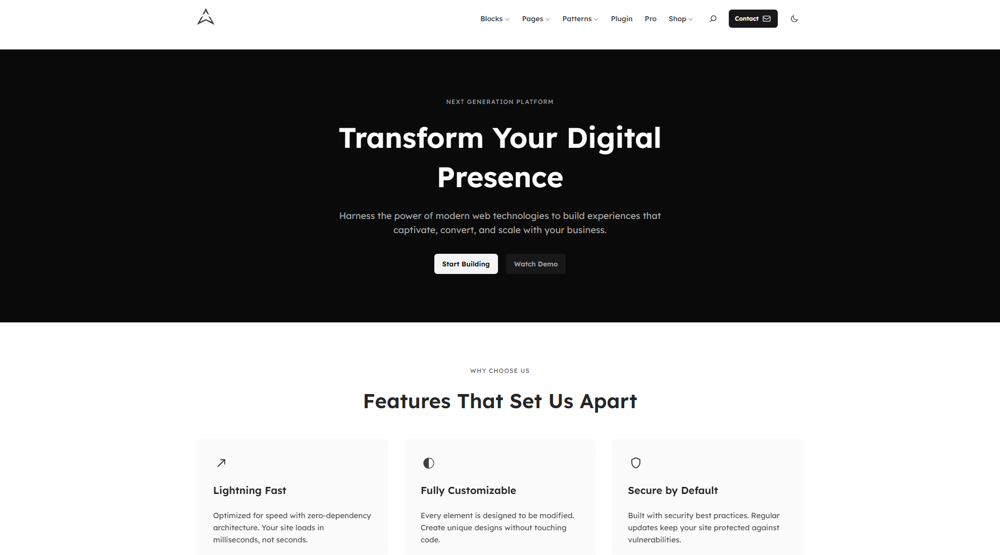

# Aegis Theme Documentation

Welcome to the official documentation for the Aegis WordPress theme. Aegis is a Full Site Editing (FSE) block theme built for performance, with a token-based design system powered by the Aegis framework.

## About Aegis

The theme provides 50 templates, 230 patterns, 60 style variations, and, through the Aegis Dash plugin, the Countdown, Slider, Toggle and Related Posts blocks. Video uses WordPress **`core/video`**, enhanced by the Aegis framework (see [[enhanced-core-blocks]]). The **Aegis framework** (`vendor/aegis/framework`) enhances 37 core blocks and registers block variations.

*The Aegis theme in its default style variation.*

Aegis plugins extend the theme (documented in their own Doc Sets):

| Product | Docs |
|---------|------|
| **Aegis Dash** (free) | [Aegis Dash docs](../../../plugins/aegis-dash/docs/home.md) |
| **Aegis Pro** (coming soon) | [Pro docs](../../../plugins/aegis-pro/docs/home.md) |
| **Aegis Ads** | [Ads docs](../../../plugins/aegis-ads/docs/home.md) |

## Documentation Contents

### Getting Started

- [[installation]] — Install and activate the theme
- [[requirements]] — System requirements (theme + plugin versions)
- [[quick-start-guide]] — Get up and running
- [[updating]] — Update safely (automatic updates from GitHub since 1.0.1)
- [[introduction-inventory]] — Everything the theme ships, counted from the files

### Using the Theme

- [[site-editor]] — Site Editor workflow
- [[templates]] — Page templates
- [[template-parts]] — Header, footer, sidebar
- [[block-patterns]] — Block patterns
- [[style-variations]] — 60 style variations
- [[global-styles]] — Typography, colors, spacing
- [[dark-mode]] — Dark mode

### Design System

- [[color-palette]], [[typography]], [[spacing]], [[shadows]], [[gradients]], [[borders]], [[layout]]

### Blocks

- [[custom-blocks]] — Theme-registered blocks (index)
- [Countdown](../../../plugins/aegis-dash/docs/blocks/countdown.md), [Slider and Slide](../../../plugins/aegis-dash/docs/blocks/slider.md), [Toggle and Toggle Content](../../../plugins/aegis-dash/docs/blocks/toggle.md), [Related Posts](../../../plugins/aegis-dash/docs/blocks/related-posts.md), [[core-video]]
- [[enhanced-core-blocks]] — Framework core block enhancements
- [[block-variations]] — Framework variations (feature toggles live in Aegis Dash)

### Features

- [[woocommerce-integration]] — WooCommerce FSE templates (theme); patterns/checkout extras → Aegis Dash
- [[plugin-integrations]] — Framework integration styling shipped with the theme
- [[hook-patterns]] — Injection hooks fired by framework (CPT management → Pro)
- [[dynamic-template-parts]] — Contextually swap header, footer, or sidebar at render time
- [[maintenance-mode]] — On-brand planned-outage page for advanced users
- [[accessibility]], [[performance]], [[navigation-styles]], [[svg-icons]], [[image-lightbox]], [[embed-template]]

### Development

- [[development-setup]], [[building-assets]], [[tools]], [[code-quality]], [[testing]], [[architecture]], [[deployment]], [[contributing]], [[documentation]]

### Reference

- [[template-reference]] — 50 templates
- [[pattern-reference]] — 230 patterns with slugs
- [[style-variations-reference]] — 60 style variations
- [[css-variables-reference]] — Every design token as a CSS custom property
- [[hooks-and-filters]] — Actions and filters
- [[code-snippets]] — Copy-ready examples
- [[file-structure]] — Repository layout

### Troubleshooting

- [[common-issues]], [[faq]]

---

**Theme Version:** 1.0.2  
**Requires WordPress:** 7.0 or later  
**Requires PHP:** 8.1 or later  
**License:** GPL-2.0-or-later
